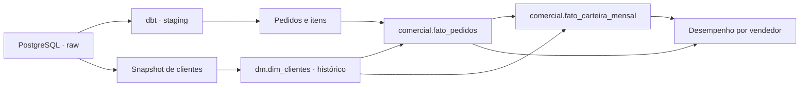

# Carteira comercial: histórico de clientes com dbt

Um cliente muda de vendedor em julho. Ao consultar as vendas de junho, o cadastro
atual já aponta para o novo responsável. Se a análise usar apenas esse cadastro,
a receita do período anterior acaba mudando de vendedor também.

Este projeto trata esse problema com um histórico de carteira no dbt. O pedido
recebe o vendedor vigente na emissão; a carteira mensal usa o cadastro no fechamento
do mês. Trabalhei com uma distribuidora fictícia, 120 clientes, seis vendedores,
18 produtos e pedidos de janeiro a dezembro de 2025. Os dados são sintéticos.

## O que há aqui

- Snapshot de clientes com histórico de vendedor, região e situação do cadastro.
- `dm.dim_clientes` com uma linha por versão do cliente.
- `comercial.fato_pedidos` com uma linha por pedido, somando seus itens.
- `comercial.fato_carteira_mensal` com uma linha por cliente e mês.
- `comercial.desempenho_vendedores` com receita, carteira e retenção mensal.
- Testes do dbt e uma comparação independente dos resultados em Python.



O foco está nas transformações e no histórico. A origem é carregada por um roteiro
local controlado; não há um serviço de ingestão nem um novo Airflow neste projeto.
PostgreSQL e dbt rodam em Docker. Não é necessário configurar Google Cloud ou
qualquer serviço pago.

## Executar

Com Docker Desktop aberto, entre nesta pasta e rode:

```sh
docker compose up -d --wait postgres
docker compose run --build --rm verificar
```

O segundo comando cria a massa, executa os snapshots e modelos em três momentos,
compara os resultados, testa erros intencionais e gera a documentação do dbt.
Os testes negativos aparecem como falha nos logs dessas etapas; o roteiro só
termina com código zero se essas falhas forem detectadas e o estado for restaurado.

**O roteiro reinicia os schemas deste projeto no banco `carteira_demo`.** Use-o
apenas com o banco sintético do Compose. O PostgreSQL tem volume, rede e nome
próprios; não usa o banco do Projeto 2 nem publica uma porta na máquina.

Os resultados ficam em `resultados/validacao.json`, com um log e um artefato dbt
por etapa. A documentação gerada fica em `target/`. Para explorá-la:

```sh
docker compose run --rm -p 127.0.0.1:8081:8081 dbt docs serve --host 0.0.0.0 --port 8081
```

Abra `http://localhost:8081`. Para encerrar o servidor, pressione Ctrl+C.
Para parar o banco sem apagar os dados, use `docker compose down`.

## Resultado da primeira execução

A validação em Docker terminou com 50 testes dbt aprovados após a recuperação.
A base final contém 1.234 pedidos, 2.466 itens e 123 versões de clientes, com
receita sintética de R$ 849.439,80 conciliada em Python. Os quatro erros controlados
foram detectados; a repetição da carga preservou o estado.
Os [registros da execução](docs/validacao.md) detalham as conferências.

## O teste de mudança de carteira

1. O cadastro inicial coloca o cliente 1 com Ana e o cliente 2 com Bruno. A primeira
   carga contém os pedidos de janeiro a junho.
2. Em 1º de julho, o cliente 1 passa para Bruno e o cliente 2, para Carla. O snapshot
   fecha as versões anteriores. Os pedidos de junho continuam com o vendedor antigo.
3. Depois da troca, chega um pedido atrasado emitido em 30 de junho. Ele permanece
   com Ana. Um pedido emitido exatamente em 1º de julho fica com Bruno.
4. Em setembro, o cliente 3 fica inativo. Agosto continua com cadastro ativo;
   setembro passa a mostrar a inativação. Uma correção de cancelamento também é
   refletida nas vendas.
5. A repetição de `dbt build` deve preservar o conteúdo das tabelas e o número de versões.

O intervalo de vigência é `[início, fim)`: inclui o instante inicial e exclui o final.
A mesma regra decide os pedidos na fronteira entre versões.

## Ler os resultados

Para consultar o PostgreSQL pelo terminal:

```sh
docker compose exec -T postgres psql -U carteira -d carteira_demo < sql/conferir_carteira.sql
```

[Regras comerciais](docs/regras-comerciais.md) explica retenção, recompra e atribuição
por vendedor. [Modelo e histórico](docs/modelo.md) detalha os grãos e a captura das
mudanças. [Validação](docs/validacao.md) registra os testes executados e suas limitações.

## Decisões e limites

As fatos são reconstruídas a cada `dbt build`. Essa escolha permite incorporar
pedidos atrasados, cancelamentos e as versões de cliente observadas sem acrescentar
outro controle incremental à demonstração. O snapshot é persistente: reconstruir
as fatos não apaga o histórico.

O snapshot só registra estados vistos nas execuções. Se a origem mudar duas vezes
entre capturas, a versão intermediária pode ser perdida. Neste cenário, o campo
`atualizado_em` informa quando a mudança entrou em vigor e os estados são carregados
na ordem correta. Um ERP com outra semântica precisaria de um campo de vigência
próprio ou de um histórico de eventos; o dbt não recupera versões que nunca leu.

Não há CDC, dashboard ou promessa de operação em produção. Os testes documentam
este caso local e o calendário fixo de 2025. Os cadastros de produtos e vendedores
mantêm somente a versão atual.

## Análises da carteira

Além do histórico de vendedores, o projeto inclui recência, queda de receita, retenção por coorte, concentração comercial e mix de categorias. As definições e limites estão em [Análises](docs/analises.md).
