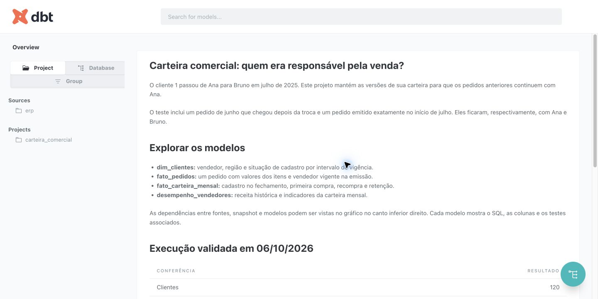

# Validação

O roteiro de integração cobre o cadastro inicial, a transferência de dois clientes,
a inativação de um terceiro, a chegada de um pedido atrasado e a correção de um
cancelamento. Cada etapa usa `dbt build`, incluindo os testes dos modelos.

Além dos testes do dbt, a conferência em Python compara contagens, receita total e
por vendedor, situações de compra e clientes retidos com um cálculo independente.
Compara também as vendas de junho antes e depois da troca de carteira e verifica
os dois pedidos na fronteira da vigência.

Quatro erros são introduzidos separadamente:

- sobreposição das vigências do cliente 1;
- desconto maior que o valor do item;
- vendedor inexistente no cadastro de origem;
- pedido de junho atribuído ao vendedor de julho.

O roteiro exige falhas de teste (`fail`), não erros de execução SQL, e restaura cada
alteração em `finally`. Depois roda a suíte novamente e compara a assinatura dos
dados com a assinatura anterior aos testes negativos.

`dbt build` não é uma transação única para todos os modelos. Um teste pode falhar
depois que uma tabela foi materializada. Neste projeto, o roteiro retorna erro e
impede considerar a execução aprovada; não há uma camada de publicação atômica.

Os logs e artefatos produzidos ficam em `resultados/`, ignorada pelo Git. Os registros
da execução de entrega ficam em `docs/evidencias/`. O workflow executa o mesmo
roteiro em um banco Docker novo; sua configuração não comprova, por si só, uma
execução no GitHub Actions.

## Execução de entrega — 06/10/2026

O roteiro completo passou no Docker, com PostgreSQL 16.8, Python 3.11.17,
dbt Core 1.10.13 e dbt-postgres 1.10.0. Cada build executou 50 testes;
a recuperação final passou nos 50, sem falhas ou avisos. Os quatro cenários
negativos produziram falhas de qualidade esperadas, sem erro de execução SQL.

| Conferência | Resultado |
|---|---:|
| Clientes | 120 |
| Versões de clientes | 123 |
| Vendedores | 6 |
| Produtos | 18 |
| Pedidos | 1.234 |
| Itens | 2.466 |
| Pedidos cancelados | 46 |
| Cliente/mês | 1.440 |
| Receita faturada sintética | R$ 849.439,80 |

O pedido atrasado `900001`, de 30/06/2025, ficou com Ana (vendedor 1), com
receita de R$ 50,00. O pedido `900002`, emitido exatamente em 01/07/2025,
ficou com Bruno (vendedor 2), com R$ 75,00. O conteúdo dos modelos e as
123 versões permaneceram iguais na repetição, assim como após restaurar os
erros controlados.

Veja o [resultado estruturado](evidencias/validacao.json), o
[log dos testes após recuperação](evidencias/09_recuperacao.log) e os
[logs das rejeições intencionais](evidencias/rejeicoes.log). As dependências
da imagem estão fixadas em `requirements-lock.txt`.

A ampliação inclui 17 modelos e 50 testes dbt. A assinatura da reexecução agora inclui as quatro novas tabelas. Uma referência independente em Python confere as médias anteriores, receita acumulada e sinais de atenção dos clientes ativos. O detalhe de itens concilia com a receita por pedido.
