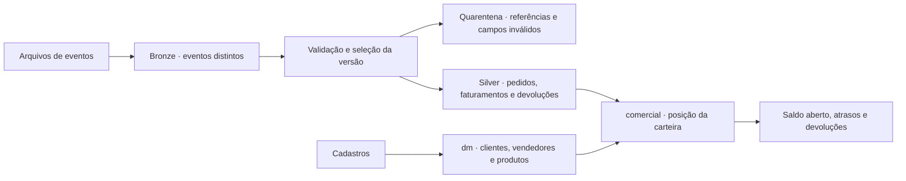

# Lakehouse comercial no Databricks

Um pedido de 11 unidades foi faturado em duas parcelas. Depois chegou uma correção na primeira parcela e uma devolução. Se cada arquivo for simplesmente somado, a receita duplica. Se a carga substituir tudo pelo último arquivo recebido, uma versão antiga pode desfazer um cancelamento.

Este projeto calcula a posição da carteira a partir de eventos versionados de pedidos, faturamentos e devoluções. A proposta é praticar PySpark, Spark SQL e Delta Lake no Databricks Free Edition, mantendo uma execução local reproduzível para conferir os resultados.

## Como os dados passam pelo pipeline



São 48 pedidos, 12 clientes, quatro vendedores e oito produtos de uma distribuidora fictícia. Os três lotes incluem duplicatas, faturamento parcial, cancelamento, correção, quantidade negativa e documentos recebidos antes da referência. O volume é intencionalmente pequeno para acompanhar cada cenário no notebook.

## Resultados conferidos

Os 12 testes Python passaram, assim como a integração com Spark e Delta Lake em Docker. A reexecução preservou o conteúdo comercial; quatro erros controlados foram detectados e corrigidos. Os três lotes fecham com 90 eventos distintos, 48 pedidos e saldo de R$ 17.250,00 a faturar. Em 15/10/2026, os três lotes também foram executados no Databricks Free Edition, com Volume do Unity Catalog e compute serverless. O Job encadeou processamento e conferência e terminou com sucesso em 4min10s. A saída confirmou 48 pedidos, R$ 4.170,00 faturados e R$ 3.975,00 após devoluções. Veja o [registro da execução](docs/validacao.md).

## Executar localmente

Com Docker Desktop aberto, nesta pasta:

```sh
docker compose run --build --rm validar
```

O teste usa Spark 4.0.0 e Delta Lake 4.0.0 de código aberto. Cria um warehouse temporário dentro do container, compara a posição com Python em cada lote e verifica reexecução, bloqueio e recuperação. Não usa o banco dos projetos anteriores. A primeira execução baixa a imagem, dependências Python e os JARs do Delta; depois de encerrar, as tabelas temporárias são descartadas. Os registros ficam em `resultados/`.

Para conferir apenas as regras Python, sem Docker ou bibliotecas adicionais:

```sh
python3 -m unittest discover -s tests -v
```

## Executar no Databricks

Siga [Primeira execução na Free Edition](docs/databricks.md). Os quatro notebooks são importáveis em formato source. A origem usa arquivos JSONL em um Volume do Unity Catalog, sem conectar o workspace ao PostgreSQL do Mac.

Os nomes no workspace seguem `p4_bronze`, `p4_silver`, `p4_dm`, `p4_comercial` e `p4_controle`, em um catálogo existente. O prefixo mantém a demonstração isolada; as tabelas incluem `dim_clientes`, `fato_carteira_pedidos` e `fato_devolucoes`.

## O que investigar

- Quanto ainda falta faturar, por cliente e vendedor?
- Qual parte da carteira está atrasada ou parcialmente faturada?
- Quanto foi devolvido e quais categorias concentram essa perda?

`03_analisar_carteira` entrega essas consultas. Os valores representam a massa sintética e não são uma previsão ou análise de uma empresa real.

## Relação com o portfólio

O Projeto 2 demonstrou ingestão PostgreSQL/API, Airflow e controle incremental. Aqui, a origem é uma exportação simulada por arquivos, e a evolução está na aplicação de mudanças sobre tabelas Delta e na operação dentro do Databricks. Não é uma integração já realizada entre os dois ambientes.

O Projeto 3 preservou histórico de carteira com dbt. Este caso muda o foco para o ciclo pedido → faturamento → devolução, com precedência de versões e documentos fora de ordem.

[Regras e limites](docs/regras.md) · [Validação](docs/validacao.md) · [Evolução do pipeline](docs/evolucao-pipeline.md)
