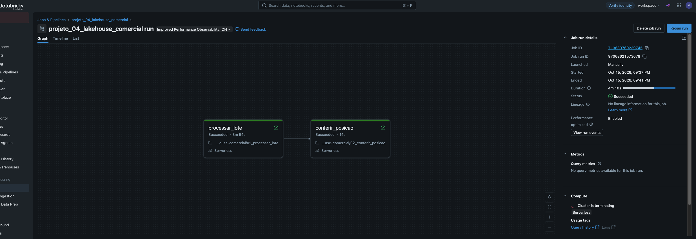
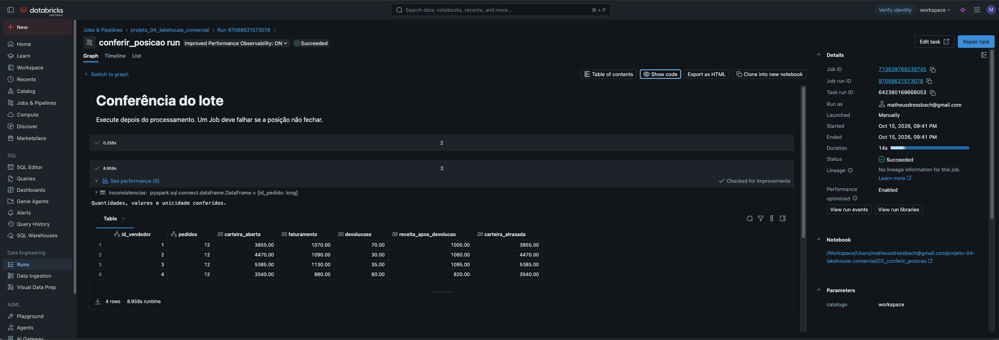

# Validação da primeira entrega

Os testes Python verificam as regras comerciais de forma independente. A integração local usa Spark e Delta Lake reais, incluindo MERGE e persistência das tabelas durante o cenário.

O roteiro confere a posição pedido a pedido em três momentos, repete um lote antigo e testa quatro bloqueios: reutilização de ID, versão ambígua, faturamento excedente e devolução excedente. Correções com novas versões devem liberar a execução e devolver a posição comercial aos valores esperados.

A execução no Databricks foi conferida pelas capturas fornecidas pelo usuário em 15/10/2026. Os testes negativos completos e a conciliação automatizada com Python pertencem à execução local.

## Execução local — 13/10/2026

Foram aprovados 12 testes de regras comerciais e o cenário completo em Docker, com Spark 4.0.0 e Delta Lake 4.0.0. O teste local fez leituras e escritas Delta reais, conciliou cada pedido com Python nos três lotes e verificou os quatro bloqueios e as versões corretivas.

| Posição após os três lotes | Resultado |
|---|---:|
| Pedidos | 48 |
| Eventos distintos na Bronze | 90 |
| Eventos na quarentena atual | 1 |
| Saldo a faturar | R$ 17.250,00 |
| Faturamento | R$ 4.170,00 |
| Devoluções | R$ 195,00 |
| Faturamento após devoluções | R$ 3.975,00 |

A única rejeição restante é a quantidade negativa da versão antiga do faturamento 999; sua correção válida já participa da posição. O teste de excesso aceita eventos na Bronze, bloqueia a Silver e exige uma versão corretiva. Por isso, após os testes negativos a Bronze tem eventos adicionais; a posição comercial recuperada é igual à dos três lotes.

[Relatório Spark](evidencias/validacao-spark.json) · [Log da integração](evidencias/spark-local.log) · [Testes Python](evidencias/testes-python.txt)

O workflow do portfólio está em `.github/workflows/projeto-04-lakehouse.yml`, com os caminhos ajustados para a pasta deste projeto. O resultado da execução no GitHub Actions deve ser conferido separadamente das evidências locais e do Databricks.

## Execução no Databricks — 15/10/2026

Os notebooks foram executados no Databricks Free Edition, com compute serverless e catálogo `workspace`. Os arquivos foram enviados ao Volume `/Volumes/workspace/p4_bronze/entrada`. Este registro se baseia nas capturas apresentadas durante a sessão, sem execução automatizada remota.

| Lote | Eventos Bronze | Quarentena | Pedidos |
|---|---:|---:|---:|
| 01_inicial | 50 | 0 | 30 |
| 02_movimento | 79 | 3 | 40 |
| 03_atrasos_e_correcao | 90 | 1 | 48 |

Duas referências pendentes foram resolvidas com a chegada dos documentos. Permaneceu a versão histórica `faturamento-999-v1`, com quantidade inválida; sua correção válida participa da posição comercial.

### Job e resultado

O Job `projeto_04_lakehouse_comercial` executou `processar_lote → conferir_posicao` sobre a base já carregada, com o terceiro lote selecionado. Não foi uma carga inicial pelo Job.

- Job ID: `713639769239745`.
- Run ID: `97068621573078`.
- Status: **Succeeded**.
- Tempo total: **4min10s**; processamento **3min54s** e conferência **14s**.
- Saída: **Quantidades, valores e unicidade conferidos.**

| Vendedor | Pedidos | Carteira aberta | Faturamento | Devoluções | Receita após devoluções |
|---|---:|---:|---:|---:|---:|
| Ana Martins | 12 | 3.855,00 | 1.070,00 | 70,00 | 1.000,00 |
| Bruno Lopes | 12 | 4.470,00 | 1.090,00 | 30,00 | 1.060,00 |
| Carla Nunes | 12 | 5.385,00 | 1.130,00 | 35,00 | 1.095,00 |
| Diego Souza | 12 | 3.540,00 | 880,00 | 60,00 | 820,00 |
| **Total** | **48** | **17.250,00** | **4.170,00** | **195,00** | **3.975,00** |

Valores monetários em reais. Toda a carteira aberta está atrasada na data de corte fixa de 30/09/2026, pois a previsão dos pedidos da massa é 20/09/2026.

### Análises conferidas

Carla apresenta a maior carteira aberta, R$ 5.385,00. O pedido 39 lidera a fila por valor aberto, com R$ 770,00 e dez dias de atraso. Limpeza tem R$ 130,00 devolvidos sobre R$ 2.240,00 faturados (5,80%); Alimentos, R$ 65,00 sobre R$ 1.930,00 (3,37%). O saldo aberto de pedidos parcialmente faturados soma R$ 4.935,00. Esses resultados descrevem apenas a massa sintética.

As capturas de 21:42:08 e 21:47:19 mostram o Job e sua conferência. As de 21:20:07, 21:22:23 e 21:24:21 mostram os lotes; as de 21:29:37, 21:29:54 e 21:30:04 mostram as análises. As imagens originais estão incluídas em `docs/evidencias/`, sem alterações.

Os quatro testes negativos, sua recuperação e a comparação automatizada pedido a pedido não foram repetidos integralmente no workspace. Os relatórios locais originais preservam `databricks_validado: false`, pois se referem ao teste local anterior; o registro separado `evidencias/validacao-databricks.json` descreve a execução posterior na plataforma.

### Capturas da execução

[Volume e arquivos](evidencias/databricks-volume.png) · [Lote inicial](evidencias/databricks-lote-inicial.png) · [Movimento](evidencias/databricks-lote-movimento.png) · [Correções](evidencias/databricks-lote-correcao.png)

[Priorização dos pedidos](evidencias/databricks-priorizacao-pedidos.png) · [Devoluções por categoria](evidencias/databricks-devolucoes-categoria.png) · [Carteira por vendedor](evidencias/databricks-carteira-vendedores.png)
